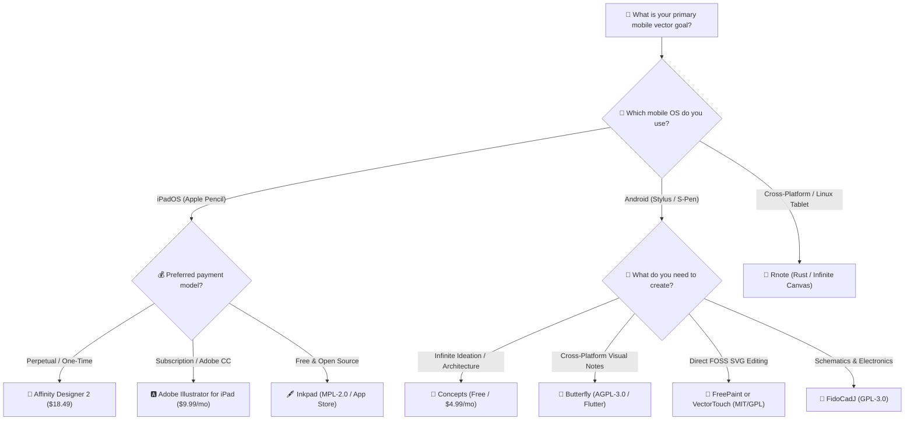

# 🎨 Awesome Mobile Vector Drawing Apps

### *The Curated Guide to Touch-Optimized SVG Editors, iPad Illustration & Android Vector Tools*

  
  
  
  
  
  
  

  <b>A comprehensive directory of production-grade SaaS platforms, offline FOSS engines, and touch-first vector drawing applications for iPadOS, Android, and mobile web.</b>

---

## 📑 Table of Contents

- [🔍 Overview & SEO Highlights](#-overview--seo-highlights)
- [🌐 Sector Overview & Market Dynamics](#-sector-overview--market-dynamics)
- [💼 SaaS & Commercial Mobile Vector Platforms](#-saas--commercial-mobile-vector-platforms)
- [🔓 Open-Source GitHub Projects](#-open-source-github-projects)
- [📐 Key Feature & Workflow Comparison](#-key-feature--workflow-comparison)
- [🛠️ How to Choose the Right Tool](#️-how-to-choose-the-right-tool)
- [🤝 How to Contribute](#-how-to-contribute)
- [💖 Support & Sponsorship](#-support--sponsorship)
- [⭐ Star History](#-star-history)
- [📜 Disclaimer](#-disclaimer)

---

## 🔍 Overview & SEO Highlights

Mobile vector illustration software bridges precision graphics engineering with natural, tactile input interfaces like the **Apple Pencil** and **Samsung S-Pen**. Unlike raster painting apps that rely on pixel grids, vector drawing apps define graphics mathematically using **Bézier paths**, **anchor points**, **fill gradients**, and **vector strokes**. This enables infinitely scalable resolution, crisp typography, and standard exports into **SVG**, **PDF**, and **EPS** workflows.

This ecosystem directory monitors both commercial mobile design suites and open-source GitHub repositories across key application domains:
- 📱 **Mobile Touch-First Interfaces:** Multi-touch gestures (two-finger undo, pinch-to-zoom, radial menus, palm rejection).
- 🖋️ **Precision Stylus Input:** Pressure sensitivity, tilt angle detection, predictive stroke smoothing, and snap-to-grid geometry.
- 📂 **Native Scalable File Formats:** Real-time Scalable Vector Graphics (SVG), Adobe Illustrator (.ai), Portable Document Format (PDF), and CAD DXF interoperability.
- 📴 **Offline-First Resilience:** Zero-telemetry, on-device vector engines for field sketching, schematic drafting, and private digital artwork.

---

## 🌐 Sector Overview & Market Dynamics

The global vector graphics and digital illustration software sector is valued at approximately **$1.45 Billion in 2024** and is projected to expand to **$2.65 Billion by 2031**, progressing at a **Compound Annual Growth Rate (CAGR) of ~8.9%**. Market expansion is propelled by hardware advances in high-refresh-rate OLED tablets, low-latency active styluses, and mobile cloud synchronization engines.

In terms of competitive structure, the market exhibits a **moderately concentrated, bifurcated dynamic**:
- **At the Enterprise & Professional Tier:** A high concentration exists around legacy creative ecosystems (notably Adobe and Canva/Affinity), where cross-device file compatibility, enterprise team libraries, and cloud collaboration create substantial vendor lock-in.
- **At the Indie, Consumer & Open-Source Tier:** The market remains **highly fragmented**. Independent developers, open-source maintainers, and specialized toolmakers capture substantial user mindshare through infinite-canvas brainstorming tools (Concepts), touch-native vector specialists (Linearity Curve), and dedicated open-source applications (Inkpad, FreePaint, Rnote) that prioritize privacy, lightweight performance, and perpetual offline ownership.

---

## 💼 SaaS & Commercial Mobile Vector Platforms

The table below lists leading commercial vector drawing applications. Entries are **sorted descending by company scale, market valuation, and annual revenue**.

| Platform / App | Company Scale / Valuation / Revenue | Pricing (Starting Tier) | Free Tier / Trial Limits | Supported Platforms & Target Audience | Key Vector Capabilities |
| :--- | :--- | :--- | :--- | :--- | :--- |
| **[Adobe Illustrator on iPad](https://www.adobe.com/products/illustrator/ipad.html)** | **Adobe Inc.** • Market Cap: ~$220B+ (NASDAQ: ADBE) • Annual Revenue: $21.5B (FY2024) | **$9.99/month** (Standalone iPad App plan via App Store) or **$22.99/month** (Single App Desktop + iPad) | **7-day free trial** with full access to all vector tools, Apple Pencil pressure/tilt, and Creative Cloud sync. No perpetual free plan; files become view-only upon expiration unless subscribed. | iPadOS (Apple Pencil optimized). Built for professional graphic designers, typographers, and brand identity studios. | Full Bézier pen tool, vector path simplifies, radial/grid repeat, live mirroring, shape maker tool, and desktop-grade `.ai` / SVG sync. |
| **[Affinity Designer 2 for iPad](https://affinity.serif.com/en-us/designer/ipad/)** | **Canva / Serif Europe** • Valuation: ~$32 Billion (Canva acquisition) • Annual Revenue: $2.3B+ | **$18.49 one-time purchase** (Perpetual iPad license; no subscription) or **$164.99** Universal V2 License (iPad, macOS, Windows) | **30-day free trial** providing 100% full feature access to all vector tools, infinite layers, precision grids, and SVG/EPS/PDF export. Document saving and editing locks after 30 days without a license. | iPadOS (M1/M2/M4 iPad Pro & Air). Built for professional digital illustrators, concept artists, and UI designers seeking zero subscriptions. | Dual vector and raster personas, precision node tool, non-destructive Boolean operators, contour tool, 1,000,000%+ zoom, and unlimited artboards. |
| **[Procreate](https://procreate.com/)** | **Savage Interactive Pty Ltd** • Valuation: ~$400M+ (Estimated) • Annual Revenue: ~$50M+ (Profitable, Bootstrapped) | **$12.99 one-time purchase** (iPad lifetime license on App Store; no recurring subscription) | **0-day free trial (Upfront purchase)**; no free tier or trial period. Single upfront purchase delivers permanent unrestricted access with zero subscriptions or in-app paywalls. | iPadOS (Apple Pencil native) & iOS (Procreate Pocket at $5.99). Built for illustrators, storyboard artists, and visual creators. | Industry-standard touch & pencil painting engine, QuickShape vector snapping, Valkyrie engine at 120 FPS, layer blend modes, and high-res export. |
| **[Linearity Curve](https://www.linearity.io/curve/)** *(formerly Vectornator)* | **Linearity GmbH** • Funding: ~$33M Total Raised (EQT Ventures) • Valuation: ~$100M (Estimated) • Annual Revenue: ~$8M | **$9.99/month** (billed annually at $99.99/yr) or **$14.99/month** (billed monthly) for Linearity Pro | **Free forever plan limited to 3 active documents/files**, 5 GB cloud storage, 1 brand profile, 2,400 welcome AI credits, standard export formats, and personal non-commercial use. | iPadOS, iOS, and macOS. Built for marketing designers, illustrators, and mobile content teams. | Auto Trace engine (raster-to-vector conversion), Shape Builder tool, custom typography tools, multi-artboard canvas, and icon design palettes. |
| **[Concepts](https://concepts.app/)** | **TopHatch, Inc.** • Valuation: ~$40M (Estimated) • Annual Revenue: ~$8M (Privately Held) | **$4.99/month** ($29.99/year) Everything Subscription, or **$39.99 one-time purchase** for Essentials Pack | **Free forever plan limited to 5 layers per drawing**, 16 core sketching tools, and flattened JPG export. Infinite canvas and unlimited sketches included; SVG/PDF/DXF vector exports require Essentials/Pro. | iPadOS, Android, Windows, and ChromeOS. Built for architects, product designers, visual note-takers, and ideation sketchers. | Infinite canvas vector engine, adjustable smoothing and pressure curves, precision measurement grids, CAD DXF/SVG export, and object libraries. |
| **[Amadine](https://amadine.com/)** | **BeLight Software, Ltd.** • Valuation: ~$15M (Estimated) • Annual Revenue: ~$3M–$5M (Indie Studio) | **$9.99 one-time purchase** for iOS/iPadOS Full Feature Pack, or **$1.99/month** / **$9.99/year** cross-platform subscription | **Free forever plan with full drawing tools and unlimited sheets**, but export is restricted to single-sheet with watermark/resolution limits, and cross-device iCloud synchronization is disabled. | iPadOS, iOS, and macOS. Built for vector artists, web graphic designers, and lettering illustrators. | High-precision pen and convert-anchor tools, path width tool, vector gradient mesh fills, multiple strokes and fills per object, and SVG export. |

---

## 🔓 Open-Source GitHub Projects

Explore community-driven, transparent, and self-hostable vector drawing applications and graphics frameworks. All repositories below are **sorted descending by real-time GitHub stargazer count**, complete with direct social stargazer badges.

### 1. 📝 [Rnote](https://github.com/flxzt/rnote) 
- **Primary Focus:** Vector-based sketching, handwritten notes, and document annotation.
- **License:** GPL-3.0 | **Language:** Rust (GTK4 / Libadwaita) | **Platforms:** Linux (touchscreen/tablets), Windows, macOS.
- **Key Features:** Built from the ground up in Rust for ultra-low latency stylus input. Features an infinite canvas, native pressure-sensitive vector ink strokes, SVG/PDF document import and export, shape recognition, and full stylus button customization.
- **Caveat:** Primarily targeted at desktop and tablet Linux distributions; mobile Android/iOS ports require experimental containers or community packages.

### 2. 🦀 [VectorCraft](https://github.com/storytold/vectorcraft) 
- **Primary Focus:** High-performance, pure Rust vector art creation engine.
- **License:** MIT / Apache-2.0 | **Language:** Rust | **Platforms:** Cross-platform (Desktop, Touch-enabled WebAssembly).
- **Key Features:** Engineered from scratch in pure Rust without bulky legacy frameworks. Offers blazing-fast path rasterization, GPU-accelerated Bézier math, and minimal memory footprint suitable for mobile WebAssembly runtimes.
- **Caveat:** Core focus is currently an architectural vector engine; specialized mobile UI shells require embedding into native touch containers.

### 3. 🖼️ [Vue Fabric Editor](https://github.com/ikuaitu/vue-fabric-editor) 
- **Primary Focus:** Web & mobile web-based vector graphics and template design editor.
- **License:** MIT | **Language:** Vue 3, TypeScript, Fabric.js | **Platforms:** Mobile Web, PWA, Desktop Browser.
- **Key Features:** Comprehensive vector and graphic design workspace with touch-gesture support, rich shape libraries, font management, SVG path manipulation, and batch image/vector exporting.
- **Caveat:** Requires a web view or browser runtime; not packaged as an offline native mobile APK/IPA out of the box.

### 4. 🌐 [SVG-Edit](https://github.com/SVG-Edit/svgedit) 
- **Primary Focus:** The reference in-browser and mobile-friendly SVG vector editor.
- **License:** MIT | **Language:** JavaScript / HTML5 | **Platforms:** Mobile Browsers, Tablets, PWA, Desktop.
- **Key Features:** Proven HTML5-based vector graphics editor that runs entirely client-side without server dependencies. Supports standard SVG elements, freehand sketching, Bézier curves, path nodes, text elements, and immediate raw SVG source inspection.
- **Caveat:** The user interface reflects traditional desktop design paradigms, requiring stylus precision on smaller phone screens.

### 5. 〰️ [SVG Path Editor](https://github.com/Yqnn/svg-path-editor) 
- **Primary Focus:** Visual creation and interactive manipulation of raw SVG path data.
- **License:** MIT | **Language:** TypeScript / Vue | **Platforms:** Touch Web, Mobile Browser, PWA.
- **Key Features:** Highly focused, intuitive tool for creating and fine-tuning Bézier curves (`C`, `S`, `Q`, `T`), lines (`L`, `H`, `V`), and arcs (`A`). Features touch-draggable control handles, coordinate snapping, and instant path minification.
- **Caveat:** Specialized strictly for single-path geometric editing rather than multi-layered full-canvas illustrations.

### 6. 🏫 [OpenBoard](https://github.com/OpenBoard-org/OpenBoard) 
- **Primary Focus:** Interactive vector whiteboard and presentation sketching application.
- **License:** GPL-3.0 | **Language:** C++ (Qt) | **Platforms:** Linux Tablets, Windows, macOS.
- **Key Features:** Clean, distraction-free vector drawing designed for stylus inputs and touch displays. Supports vector pens, highlighters, geometric compasses, virtual rulers, and multi-page vector PDF presentations.
- **Caveat:** Built primarily for classroom and lecture hardware; lacks specialized illustration tools like Boolean path uniting or gradient mesh.

### 7. 🎯 [Method Draw](https://github.com/methodofaction/Method-Draw) 
- **Primary Focus:** Lightweight, clean vector drawing tool built for rapid SVG production.
- **License:** MIT | **Language:** JavaScript | **Platforms:** Mobile Web, Tablets, Desktop.
- **Key Features:** Streamlined fork of SVG-edit with a modernized, uncluttered aesthetic. Offers responsive canvas resizing, essential vector shapes, line and curve tools, color pickers, and clean SVG export.
- **Caveat:** Lacks advanced layer blending modes, clipping masks, and auto-tracing capabilities.

### 8. ⚡ [GodSVG](https://github.com/MewPurPur/GodSVG) 
- **Primary Focus:** Structured, human-readable SVG file editing powered by the Godot Engine.
- **License:** MIT | **Language:** GDScript / C++ | **Platforms:** Desktop, Web, Android-compatible foundation.
- **Key Features:** Treats SVG as structured data rather than an opaque canvas. Guarantees zero unnecessary SVG bloat, preserves custom markup formatting, and serves as the underlying engine for touch-native ports like VectorTouch.
- **Caveat:** Currently in active development; desktop-centric UI is being adapted for handheld devices.

### 9. 🖋️ [Inkpad](https://github.com/sprang/Inkpad) 
- **Primary Focus:** The premier open-source iPad vector illustration application.
- **License:** MPL-2.0 | **Language:** Objective-C | **Platforms:** iPadOS (App Store & Source Build).
- **Key Features:** Designed from scratch specifically for the iPad touch architecture. Handles thousands of shapes with zero lag, supports unlimited layers, compound paths, Bézier pen tool, Boolean operators (Unite, Intersect, Exclude, Subtract), gradient fills, and direct SVG/PDF export.
- **Caveat:** Exclusive to the Apple iPad ecosystem; codebase is mature but sees infrequent upstream updates.

### 10. 🦋 [Butterfly](https://github.com/LinwoodDev/Butterfly) 
- **Primary Focus:** Minimalist cross-platform vector sketching and infinite canvas note application.
- **License:** AGPL-3.0 | **Language:** Dart (Flutter) | **Platforms:** Android, iOS, Windows, Linux, Web.
- **Key Features:** Built with Flutter for smooth 60/120 FPS performance across phones and tablets. Features an infinite canvas, stylus and palm rejection support, editable vector line art, shape insertion, local-first offline storage, and SVG/PDF export.
- **Caveat:** Prioritizes visual notes and diagrammatic sketches over complex multi-stop gradient illustrations.

### 11. 📐 [TouchVG](https://github.com/rhcad/TouchVG) 
- **Primary Focus:** Lightweight 2D vector drawing framework for mobile operating systems.
- **License:** BSD-3-Clause | **Language:** C++ / Java / Objective-C | **Platforms:** iOS, Android, Windows.
- **Key Features:** High-speed cross-platform core library engineered for custom mobile vector app development. Implements gestures, spatial indexing, path intersections, undo/redo stacks, and CAD-style snapping.
- **Caveat:** It is a developer framework and toolkit rather than a ready-to-use end-user illustration app.

### 12. 🔌 [FidoCadJ](https://github.com/FidoCadJ/FidoCadJ) 
- **Primary Focus:** Multi-platform 2D vector CAD editor with specialized Android support.
- **License:** GPL-3.0 | **Language:** Java | **Platforms:** Android, macOS, Linux, Windows.
- **Key Features:** Highly accessible vector tool equipped with built-in electronic, logic, and schematic symbol libraries. Exports to PDF, EPS, PGF for LaTeX, SVG, and high-resolution PNG.
- **Caveat:** Tailored specifically toward electronic schematics and technical drafting rather than freehand creative illustration.

### 13. 🎨 [FreePaint](https://github.com/pastthepixels/FreePaint) 
- **Primary Focus:** Native Material Design 3 vector drawing app for Android.
- **License:** GPL-3.0 | **Language:** Kotlin | **Platforms:** Android (Available via F-Droid & GitHub Releases).
- **Key Features:** Lightweight, ad-free vector drawing app that saves and loads standard SVG files directly on mobile storage. Supports open and closed Bézier paths, fill/stroke customization, eraser tools, and marquee selection.
- **Caveat:** Lacks complex illustration features such as multiple layers, Boolean operations, text objects, and gradient meshes.

### 14. 🦦 [Capy Canvas](https://github.com/capyatelier/capycanvas) 
- **Primary Focus:** Modern GPU-accelerated illustration and painting studio.
- **License:** GPL-3.0 | **Language:** Rust (wgpu) | **Platforms:** iPad, Android, Linux, Windows, macOS, Web.
- **Key Features:** Next-generation creative app engineered with Rust and wgpu for 120+ FPS canvas rendering. Features workspaces for sketching, painting, and vector-compatible workflows with HDR color support.
- **Caveat:** Actively evolving in public alpha; mobile touch ergonomics are undergoing rapid iteration.

### 15. 📱 [VectorTouch](https://github.com/syntaxerror247/VectorTouch) 
- **Primary Focus:** Touch-optimized mobile SVG editor for Android devices.
- **License:** MIT | **Language:** GDScript (Godot Engine) | **Platforms:** Android (Google Play & GitHub Releases).
- **Key Features:** Brings the power of structured SVG editing to mobile screens with touch-friendly handles, clean node manipulation, and direct filesystem SVG saving.
- **Caveat:** Early-stage project under active development; advanced path tools and complex SVG filters are still maturing.

---

## 📐 Key Feature & Workflow Comparison

| Application / Project | License Model | Platform Availability | Stylus & Pressure | Infinite Canvas | Layer System | Boolean Operations | Native SVG File Output |
| :--- | :--- | :--- | :---: | :---: | :---: | :---: | :---: |
| **Adobe Illustrator iPad** | Commercial Subscription | iPadOS | ✅ Yes | ❌ Fixed Artboards | ✅ Unlimited | ✅ Full Set | ✅ Full SVG & AI |
| **Affinity Designer 2** | Commercial Perpetual | iPadOS | ✅ Yes | ❌ Fixed Artboards | ✅ Unlimited | ✅ Non-destructive | ✅ High Precision |
| **Linearity Curve** | Freemium SaaS | iPadOS, iOS, macOS | ✅ Yes | ❌ Multi-Artboard | ✅ Tier Capped | ✅ Full Set | ✅ Standard SVG |
| **Concepts** | Freemium | iPadOS, Android, Windows | ✅ Yes | ✅ Infinite | ⚠️ 5 (Free) / ∞ (Pro) | ❌ Stroke-level | ⚠️ Paid Tier Only |
| **Inkpad** | Open Source (MPL-2.0) | iPadOS | ✅ Yes | ❌ Fixed Canvas | ✅ Unlimited | ✅ Full Set | ✅ Direct SVG/PDF |
| **Rnote** | Open Source (GPL-3.0) | Linux Tablets, Win, Mac | ✅ Yes | ✅ Infinite | ✅ Multi-layer | ❌ Drawing focused | ✅ Clean Vector SVG |
| **Butterfly** | Open Source (AGPL-3.0) | Android, iOS, Win, Web | ✅ Yes | ✅ Infinite | ✅ Layer areas | ❌ Visual notes | ✅ Direct SVG/PDF |
| **FreePaint** | Open Source (GPL-3.0) | Android | ⚠️ Basic | ❌ Fixed Canvas | ❌ Single Layer | ❌ None | ✅ Direct SVG |
| **VectorTouch** | Open Source (MIT) | Android | ⚠️ Touch handles | ❌ Bounded SVG | ⚠️ Hierarchy tree | ⚠️ Under dev | ✅ Pure SVG Code |

---

## 🛠️ How to Choose the Right Tool

---

## 🤝 How to Contribute

Contributions from designers, mobile engineers, and open-source advocates are warmly welcomed!

1. 🍴 **Fork the repository** on GitHub.
2. 🌿 **Create a descriptive branch:** `git checkout -b feature/add-new-vector-app`
3. 📝 **Add or update entries in `README.md`:**
   - Adhere strictly to existing formatting standards.
   - For SaaS apps, provide exact starting pricing and exact free-tier limits (no generic text).
   - For open-source apps, include a verified GitHub star social badge linked to `/stargazers`.
4. 🚀 **Submit a Pull Request** with a concise summary of the changes and official source links.

---

## 💖 Support & Sponsorship

If this curated directory has helped you discover the right mobile vector drawing tools, improve your touch illustration workflow, or build better graphics software, please consider supporting the project:

- ⭐ **Star this repository** to improve discoverability for creators worldwide.
- 🍴 **Fork and share** with fellow designers, artists, and open-source developers.
- ☕ **Support future development and curation** by sponsoring via the link below:

  

*Thank you for supporting open-source software, transparent creative tools, and the mobile vector illustration ecosystem!*

---

## ⭐ Star History

---

## 📜 Disclaimer

- This repository is a **community-curated index** created for informational, educational, and developer evaluation purposes. Mentions do not imply commercial endorsement.
- All product names, logos, trademarks, and registered trademarks belong to their respective owners.
- Pricing, subscription models, and free-tier limitations are subject to change by respective vendors. Please verify current terms on official vendor websites before purchasing.

  Maintained with ❤️ for the global mobile creative community • Built for iPad, Android, and stylus artists everywhere.

